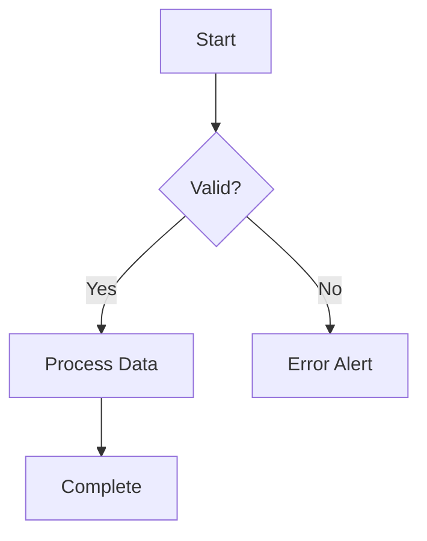
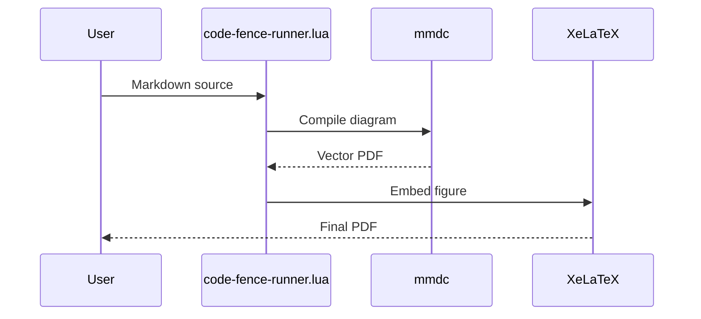
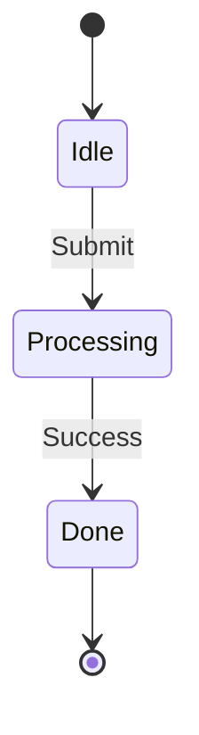

# Pipeline Rendering Rules & Language Reference

This document is the authoritative reference for how content is parsed, transformed, executed, and rendered across all supported languages in the latest version of the Markdown-to-PDF pipeline.

---

## 1. Architectural Pipeline Overview

Every document processed by `compile.bat` flows through a strictly ordered multi-stage pipeline:

```
Input File (.md / .txt)
   │
   ▼
[Stage A: Source Normalization] ─── markdown-normalizer.lua
   │  • Unicode math symbol mapping & invisible character scrubbing
   │  • Fenced YAML metadata extraction & stripping
   │  • Universal block boundary spacing & table math preservation
   │
   ▼
[Pandoc AST Parsing]
   │  • -raw_tex: Disables raw TeX parsing so backslashes in prose are safely escaped
   │  • -simple_tables: Disables fragile dash-parsing to avoid breaking Markdown prose
   │  • -yaml_metadata_block: Suppresses classic '---' blocks in favor of fenced YAML
   │
   ▼
[Stage B: AST Transformation] ─── markdown-normalizer.lua
   │  • Header, figure, task list, and math font normalization (\mathbf, \mathnormal)
   │  • Table formatting & bibliography resolution (--citeproc)
   │
   ▼
[Stage C: Code Fence Execution & Caching] ─── code-fence-runner.lua
   │  • Language dispatch (Python, C, C++, Java, LaTeX, YAML, Text)
   │  • Universal TeX group isolation: {\begingroup ... \par\endgroup}
   │  • Preamble hoisting with \let\cmd\relax safety & local font-family scoping
   │  • Cross-fence global command conflict protection (demotion to run=false)
   │  • Snippet auto-wrapping (#line 1 in C/C++; class Main in Java)
   │  • SHA-1 cache lookup & dependency tracking (rf4 cache schema)
   │
   ▼
[XeLaTeX Multi-Pass Compilation] ─── compile.bat
   │  • Passes 1 to 3 with label/reference change detection
   │  • max_print_line=1000 for full error message capture
   │
   ▼
[Error Recovery Fallback] ─── error-annotator.lua
   │  • Localizes syntax crashes to the offending line
   │  • Neutralizes the line with \detokenize and marks it with red [!!!] boxes
   │
   ▼
Final Output PDF (Delivered beside first input file)
```

---

## 2. Master Language Index & Classification

The pipeline recognizes **8 distinct language categories**, each with its own execution model, isolation guarantees, and output formatting:

| Language Identifier | Aliases | Classification | Execution Engine | Primary Output in PDF |
|---|---|---|---|---|
| **Markdown** | `md`, `markdown`, *(plain prose)* | Document Body & Typography | Pandoc + `markdown-normalizer.lua` | Formatted text, headings, tables, formulas |
| **YAML** | `yaml`, `.yaml`, `{yaml}`, `{.yaml}` | Document Configuration | Lua Pre-processor (Stage A) | Metadata injection (or code listing if `run=false`) |
| **LaTeX / TeX** | `latex`, `tex` | Direct Vector & Math Typesetting | XeLaTeX via `code-fence-runner.lua` | Rendered document graphics/math inside local TeX group |
| **Python** | `python`, `py`, `python3`, `py3` | Dynamic Script Execution | Windows `py` launcher + SHA-1 Cache | Console stdout + Matplotlib figures + Error boxes |
| **C** | `c` | Compiled Native Binary | `gcc -O2` + Auto-Wrapper + Cache | Console stdout + Compiler errors |
| **C++** | `cpp`, `c++`, `cxx`, `cc` | Compiled Native Binary | `g++ -O2 -std=c++17` + Auto-Wrapper + Cache | Console stdout + Compiler errors |
| **Java** | `java` | JVM Compiled / Script Execution | `javac` / `java` + Auto-Wrapper + Cache | Console stdout + JVM diagnostics |
| **Mermaid** | `mermaid`, `mmd` | Declarative Vector Diagram | `mmdc` (Mermaid CLI) + Vector PDF + Cache | Standalone vector diagram with optional `caption` and `width` |
| **Raw / Gibberish Text** | `text`, `txt`, *(no tag)* | 100% Crash-Proof Verbatim | LaTeX `fvextra` Verbatim Engine | Verbatim text box with automatic line-wrapping |

---


## 3. Language-by-Language Deep Dive

---

### 3.1. Markdown (`md`, `markdown`, Plain Prose)

#### How It Renders Under the Hood
* **Normalizer Interception:** In Stage A, `markdown-normalizer.lua` scans the document before Pandoc touches it. It scrubs invisible Unicode characters, normalizes lookalike math symbols (converting raw Unicode Greek `α`, `β`, arrows `→`, and operators `≤`, `∫` into their correct LaTeX counterparts `\alpha`, `\beta`, `\to`, `\le`, `\int`), and aggregates stacked super/subscripts (`x¹²` $\rightarrow$ `x^{12}`). Full Latin and Greek subscript coverage (`ₐ ₑ ₕ ᵢ ⱼ ₖ ₗ ₘ ₙ ₒ ₚ ᵣ ₛ ₜ ᵤ ᵥ ₓ` and `ᵦ ᵧ ᵨ ᵩ ᵪ`) is guaranteed in both math mode (`x_{i}`) and text mode without font glyph dropouts.
* **Stray TeX Protection (`-raw_tex`) & AST-Preserved Constructs:** Pandoc runs with `-raw_tex` disabled. Unfenced arbitrary LaTeX commands typed in ordinary paragraphs (e.g. `\lhead{Notes}` or `\mycommand`) are **not** executed by XeLaTeX; they are automatically escaped to literal text (`\textbackslash{}lhead\{Notes\}`) so they can never crash the build. Meanwhile, standard document cross-references (`\ref{...}`, `\ref*{...}`, `\eqref{...}`, `\autoref{...}`, `\pageref{...}`, `\nameref{...}`, `\cite{...}`, `\cite[...]{...}`), hyperlinks (`\url{...}`, `\href{...}{...}`), footnotes (`\footnote{...}`), non-breaking ties (`~` / `\nobreakspace{}`), page/spacing commands (`\newpage`, `\clearpage`, `\pagebreak`, `\bigskip`, `\medskip`, `\smallskip`, `\vspace`, `\hspace`), typographic primitives (`\hfill`, `\noindent`, `<sub>...</sub>`, `<sup>...</sup>`, `<br>`), and non-Latin Unicode scripts (Bengali, Hindi, CJK routed to Babel fonts) are preserved and converted to native unescaped AST nodes so they render cleanly in LaTeX. Structural pagebreaks on their own line are isolated as block boundaries to prevent unintended paragraph merging.
* **Local File & Document Links:** Links to local files (e.g. `[notes](file:///D:/path/file.pdf)` or `[doc](D:/notes/doc.pdf)`) are automatically normalized in Stage B AST processing: `file:///` and `file://` prefixes are stripped, URL percent-encodings (such as `%20`) are decoded to filesystem paths, and targets are routed through `\href{run:...}`. This creates native OS-level file launch actions (`/S/Launch`) in the PDF, allowing desktop PDF viewers (such as SumatraPDF or Acrobat) to open the referenced document in its default external application without path corruption.
* **CommonMark Code Span Boundaries:** Backticks inside inline code spans are parsed strictly under CommonMark rules: preceding backslashes do not escape closing backticks (e.g. `` `C:\Windows\` `` closes properly and never leaks into subsequent text).
* **Table & Layout Safety (`-simple_tables`):** Pandoc's `simple_tables` extension is disabled. Three consecutive dashes (`---`) typed on their own line are always treated as a visual horizontal rule divider, never as an unclosed table row. Pipe tables (`| col | col |`) receive universal boundary spacing (including blockquote prefix preservation) to prevent merging with surrounding text.
* **Nested Environment & Display Math Robustness:** Theorem-like and quote environments can be nested to arbitrary depths (`\begin{theorem}...\begin{quote}...\end{quote}...\end{theorem}`) via a re-entrant stack in `markdown-normalizer.lua`. Bare AMS math environments (`\begin{align}`, `equation`, `gather`, `multline`, etc.) appearing directly in Markdown prose without math delimiters are automatically wrapped in `$$\n...\n$$`, ensuring they are parsed natively as DisplayMath rather than escaped to `\textbackslash begin` under `-raw_tex`. Blockquote nesting is preserved so greater-than markers never corrupt display math formulas. Any custom theorem environment declared via `\newtheorem` is dynamically registered into `REGISTRY.DIV_ENVS`, enabling native Markdown Div conversion. Display math (`$$...$$`) unwraps `\begin{align}` even when preceded or followed by text or comments, and inline currency amounts (e.g. `$50 (base_fee = $30)`) are strictly isolated from math delimiter heuristics.

#### Examples

**Basic Typography and Equations:**
```markdown
# 1. Classical Mechanics

A particle of mass $m$ experiencing a restoring force has potential energy:

$$V(x) = \frac{1}{2} k x^2$$

Unicode symbols like α, β, and ∫ are automatically converted to LaTeX math:
The integral ∫ from 0 to ∞ of $e^{-x}\,dx = 1$.
```

**Pipe Table & Task Lists:**
```markdown
| Parameter | Symbol | Nominal Value | Units |
|---|:---:|:---:|---|
| Mass | $m$ | 1.50 | kg |
| Spring Constant | $k$ | 250 | N/m |

- [x] Derivation verified
- [ ] Experimental calibration completed
```

---

### 3.2. YAML (`yaml`, `.yaml`)

#### How It Renders Under the Hood
* **Stage A Extraction:** Fenced YAML blocks (tagged ```` ```yaml ```` or ```` ```{.yaml} ````) are intercepted and extracted in Stage A **before** Pandoc parses the document body. The metadata is stored in Pandoc's `doc.meta` table, and the YAML fence is completely stripped from the visible body.
* **Elimination of Traditional `--- ... ---`:** Standard Markdown frontmatter (`---`) is deliberately disabled. This ensures that hyphens, horizontal divider rules, and negative numbers can never be misparsed as broken YAML headers.
* **Supported Layout Presets:**
  * `page-layout: presentation`: Switches page geometry from standard portrait A4 to 16:9 widescreen landscape (13.33 in $\times$ 7.5 in, 0.5 in margins) with scaled headings.
  * `page-layout: whiteboard`: Generates a continuous canvas page (with 0.5 in margins) whose height dynamically and precisely expands to fit all content (two-pass `.aux` height auto-calibration up to a 100 in ceiling). When content exceeds the 100 in height limit, it cleanly starts a new whiteboard canvas page. Width is flexible with a minimum floor of 11.0 in and an upper safety ceiling of 100.0 in (matching the 100-inch height limit); it automatically expands when multi-column tables, nested color/margin boxes (`11.0 + (depth - 1) * 1.5` in), or wide code blocks (`> 70` chars per line) require extra horizontal clearance to prevent column overlap or cramping. Authors may also supply an explicit override via `page-width:` or `whiteboard-width:` (e.g. `16in`), strictly enforced between the 11.0 in floor and 100.0 in ceiling. Boxes are breakable across page boundaries so content flows cleanly when hitting the height limit without clipping or TeX dimension overflow. Strict manual pagebreak prohibition is enforced: any manual page break (`\newpage`, `\pagebreak`, `\clearpage`, `\cleardoublepage`, `\eject`, `\tcbbreak`, `::: {.pagebreak}`) in Markdown or LaTeX code fences is automatically converted into an elegant horizontal canvas section divider line.
  * `page-layout: whiteboard_html`: Produces the full continuous whiteboard XeLaTeX PDF, and as the final compilation step, converts the generated LaTeX into a standalone, interactive HTML document (`.html`) tailored for Windows desktop Chrome using Vincent Dörig's `LaTeX.css` and MathJax (`tex-svg-full.js`, bundling `boldsymbol`, `ams`, `physics`, and SVG glyph paths so inlined builds work cleanly without autoload/font failures). The HTML whiteboard canvas mirrors the PDF's dynamic width expansion: `html-collapsible-boxes.lua` extracts the `% WHITEBOARD_WIDTH:` calculated by `markdown-normalizer.lua` (or falls back to AST box nesting depth) and injects `--whiteboard-width` / `--document-width` CSS variables, expanding `body` horizontally even past narrow viewports so nested boxes and wide multi-column tables retain full reading room. Nested `marginbox`/`tcolorbox`/`vbox` environments start collapsed as interactive HTML5 `<details>` and `<summary>` elements with hierarchical progressive disclosure (clicking any parent reveals only its immediate children, preserving exact titles or `'Click for more info'`, and using the exact box colors). Vector graphics (`tikzpicture`, `circuitikz`, `chemfig`, `quantikz`, `forest`) and `\begin{htmlsvg}...\end{htmlsvg}` blocks are preprocessed via XeLaTeX-to-SVG (`dvisvgm --no-fonts`) and embedded as inline base64 SVGs while staying native LaTeX in PDF. Also includes horizontal scroll wrappers on wide formulas/tables/code blocks, automatic system dark mode (`@media (prefers-color-scheme: dark)`), a floating reading toolbar (**Expand/Collapse All**, **Theme**, **Scroll to Top**), and a print stylesheet (`@media print`) that expands all collapsible boxes and resets `body` width to `100%` when printing or saving as PDF.
  * `title-rule: false`: Disables the horizontal decorative rule rendered beneath the document title block.
  * `header-left: "..."`: Sets the running header on the top left of every page (defaults to "Notes").
* **Verbatim Listing Mode (`run=false`):** When you need to display YAML code in your document without applying it to the document's settings, add `run=false`. The pre-processor ignores it as metadata and leaves it as a syntax-highlighted code block.

#### Examples

**Document Metadata Configuration (Default):**
````markdown
```yaml
title: "Quantum Field Theory: Problem Set 4"
author: "Biswanath Sen"
date: "2026-11-08"
header-left: "Physics 401: QFT"
page-layout: default
title-rule: true
```
````

**Verbatim Code Listing (`run=false`):**
````markdown
```yaml run=false
# This block is NOT applied as document metadata.
# It renders as a syntax-highlighted code block in the PDF!
database:
  host: "127.0.0.1"
  port: 5432
  pool_size: 20
```
````

---

### 3.3. Universal LaTeX Permeables (`latex_unv`, `tex_unv`)

#### How It Renders Under the Hood
* **Single Dedicated Universal Preamble Fence:** Code fences tagged `latex_unv` or `tex_unv` are the exclusive mechanism for declaring custom universal (document-wide) permeables. Exactly **one** `latex_unv` block is allowed per document; any subsequent `latex_unv` blocks automatically demote to `run=false` (syntax-highlighted code listing).
  * **Pure Preamble Mode (No `\begin{document}`):** The entire block is treated as universal preamble. It is hoisted directly to Pandoc's `$header-includes$` as-is, pure and untouched (Overleaf-style pass-through).
  * **Pasted Document Mode (With `\begin{document}`):** The position relative to `\begin{document}` defines the boundary:
    * **Before `\begin{document}`:** Strips `\documentclass` boilerplate and hoists all remaining preamble lines raw to `$header-includes$`.
    * **After `\begin{document}`:** Renders locally in the document body inside an isolated group (`{\begingroup...\par\endgroup}`).
* **Direct Pass-Through Architecture:** No regex AST parsing or command modifying is performed. Whatever is written in the preamble area of `latex_unv` goes directly to the LaTeX engine.

#### Examples

**Pure Universal Macro & Package Declarations:**
````markdown
```latex_unv
\usepackage{amsmath}
\DeclareMathOperator{\myop}{myop}
\let\eps\varepsilon
\newcommand{\darcy}{\mathbf{q} = -\frac{k}{\mu}\nabla p}
```
````

**Pasted Full LaTeX Document:**
````markdown
```latex_unv
\documentclass{article}
\usepackage{amsmath}
\DeclareMathOperator{\sinc}{sinc}
\begin{document}
Here is text inside the body of the pasted document: $\sinc(x) = \frac{\sin x}{x}$.
\end{document}
```
````

---

### 3.3.1. Standard Local LaTeX / TeX (`latex`, `tex`)

#### How It Renders Under the Hood
* **Direct Raw LaTeX Output:** Code fences tagged `latex` or `tex` are emitted directly into the generated `.tex` file as raw LaTeX.
* **Universal Code Fence Isolation:** Every standard `latex` fence is strictly wrapped inside a local group:
  ```latex
  {\begingroup
  <user-code>
  \par\endgroup}
  ```
  Local macros, low-level TeX primitives (`\def`, `\let`), font families, color overrides, or dimension adjustments made inside a standard block **cannot leak** into subsequent sections.
* **The `\use...` and `\Require...` Library Import Exception for AI Chat Pastes:** When pasted documents or snippets (e.g. from ChatGPT, Claude, or Gemini) contain library and package import lines starting with `\use` or `\Require` (`\usepackage`, `\RequirePackage`, `\usetikzlibrary`, `\usepgfplotslibrary`, etc.) before `\begin{document}`, the runner extracts and hoists them to the document preamble (deduplicating to avoid clashes) and strips `\documentclass` and `\begin{document}...\end{document}` so local diagrams and body content render seamlessly.
* **Strict Preamble & Scaffolding Prohibition:** 
  * If **anything else** appears before `\begin{document}` in standard `latex` (e.g. `\newcommand`, `\def`, custom setup), **the fence will NOT run (`run=false`)**.
  * Custom global definitions and preambles strictly require the single `latex_unv` fence.
* **Scaffolding Macro Protection:** If user LaTeX code attempts to redefine critical document scaffolding macros (`\maketitle`, `\tableofcontents`, `\title`, `\author`, `\date`), the runner automatically demotes the block to `run=false` (syntax-highlighted code listing).

#### Examples

**Rendered TikZ Vector Graphic (Default):**
````markdown
```latex
\begin{tikzpicture}[scale=1.2]
  \draw[thick, ->] (-2,0) -- (2,0) node[right] {$x$};
  \draw[thick, ->] (0,-1) -- (0,2) node[above] {$y$};
  \draw[domain=-1.5:1.5, smooth, variable=\x, blue, thick] plot ({\x}, {\x*\x});
  \node[blue, right] at (1.2, 1.44) {$y = x^2$};
\end{tikzpicture}
```
````

**Syntax-Highlighted Listing Only (`run=false`):**
````markdown
```latex run=false
\documentclass{article}
\usepackage{geometry}
\begin{document}
Hello World!
\end{document}
```
````

**Show Source Code AND Render Output (`show=true`):**
````markdown
```latex show=true
\colorbox{yellow!30}{\textbf{Important Note:}} This text is displayed in a colored box.
```
````

---

### 3.4. HTML SVG Safety Net Fence (`htmlsvg`, `svg`) & Automatic MathJax Fallback

#### How It Renders Under the Hood
* **Dedicated Safety Net Fence:** Code fences tagged ````htmlsvg```` or ````svg```` provide a universal safety net for complex LaTeX tables, diagrams, and arbitrary formulas where web math/HTML parsers (like MathJax) fail or lack package support.
* **Dual-Engine Behavior:**
  * **XeLaTeX PDF:** Renders natively as pure LaTeX within an isolated group (`{\begingroup...\par\endgroup}`) via the `\newenvironment{htmlsvg}{}{}` passthrough in `custom.tex`. Zero performance penalty, full vector fidelity, and crisp selectable text.
  * **Whiteboard HTML:** When compiling with `page-layout: whiteboard_html`, `tex-to-html-preprocessor.lua` intercepts the block, compiles the snippet with standalone XeLaTeX (`xelatex -no-pdf` + `dvisvgm --no-fonts`), and converts it to a clean vector SVG. The SVG is cached by MD5 hash in `md2pdf_cache` and embedded directly into the standalone HTML document (`data:image/svg+xml;base64,...`).
* **Automatic Build-Time Fallback (Method 1 Heuristic Analysis):** In addition to manual ````htmlsvg```` fences, `tex-to-html-preprocessor.lua` inspects all display math (`\[...\]`), inline math (`\(...\)`), and LaTeX environments during HTML export. Any block containing constructs unsupported by MathJax (e.g. TikZ `\draw`/`\node`, nested `tabular`, `\diagbox`, `\chemfig`, quantum circuits `\qw`/`\gate`, TeX layout primitives like `\raisebox`) is automatically detected at compile time and routed to SVG generation, while standard mathematical formulas remain lightweight native MathJax.
* **Algorithmic Unicode Math Normalization:** Plane-1 Unicode math symbols (such as bold vectors, Greek operators, and superscripts) within the fence or math blocks are automatically normalized before compilation.

#### Examples

**Complex LaTeX Table Rendered Natively in PDF and as SVG in HTML:**
````markdown
```htmlsvg
\begin{tabular}{llr}
\toprule
\multicolumn{2}{c}{General Quantum Operator} & Commutator \\
\midrule
Position \& Momentum & $[\hat{x}, \hat{p}]$ & $i\hbar$ \\
Potential \& Momentum & $[𝐕(𝐱),\boldsymbol𝚷]$ & $\mathbf{0}$ \\
\bottomrule
\end{tabular}
```
````

---

### 3.5. Python (`python`, `py`, `python3`, `py3`)

#### How It Renders Under the Hood
* **Execution & Launcher:** Python blocks are executed via the Windows Python launcher (`py`). The active working directory is scoped to the directory of the first input file.
* **Wrapper Injection:** The code is executed through a synthesized wrapper script that imports `sys`, `os`, and `io`, monkey-patches `matplotlib.pyplot.show()` to silently export figures to PNG/PDF files on disk, and captures `stdout`/`stderr`.
* **LIFO `atexit` Sequencing:** Python's exit hooks flush stdout before writing dependency records, preventing output buffer truncation.
* **Audit-Hook Dependency Tracking:** Uses Python's native `sys.addaudithook` to passively observe every `open()` call made by user code. Any read files have their SHA-1 digests automatically recorded and added to the block's cache key.
* **Persistent SHA-1 Cache (`rf4` Schema):** A unique key is computed from:
  $$\text{Key} = \text{SHA-1}(\text{Code} + \text{Spec ID} + \text{Python Version} + \text{Installed Packages} + \text{Input Dir} + \text{Dependencies})$$
  Cached outputs (`.out`, `.err`, `.meta`, figures) are reused instantly on subsequent builds.
* **Security & Approval Prompts:** Uncached Python runs display the full code on the Windows console and pause for approval (`[Y/n]`). Passing `trusted=true` skips the prompt for normal runs.
* **Error Resilience:** Python exceptions do not crash the PDF build. The traceback tail (up to 15 lines) is captured and rendered inside a clear red error frame in the PDF.

#### Examples

**Data Calculation with Output Limits:**
````markdown
```python trusted=true maxlines=5
# Output is capped at 5 lines; surplus lines are truncated cleanly
for i in range(1, 20):
    print(f"Sample {i}: reading = {i * 1.414:.4f}")
```
````

**Embedded Matplotlib Visualization:**
````markdown
```python trusted=true show=false
import numpy as np
import matplotlib.pyplot as plt

x = np.linspace(0, 10, 200)
y = np.sin(x) * np.exp(-x / 4)

plt.figure(figsize=(6, 3))
plt.plot(x, y, color='darkblue', lw=2)
plt.title("Damped Harmonic Oscillator")
plt.xlabel("Time (s)")
plt.ylabel("Displacement (m)")
plt.grid(True, alpha=0.3)
plt.tight_layout()
plt.show()
```
````

**Declared File Dependencies & Forced Refresh:**
````markdown
```python run=new trusted=true deps="dataset.csv"
# Forces a fresh execution and invalidates cache if dataset.csv changes
with open("dataset.csv", "r") as f:
    header = f.readline().strip()
print(f"Columns: {header}")
```
````

---

### 3.5. C (`c`)

#### How It Renders Under the Hood
* **Compiler Invocation:** Compiled with `gcc -O2 -o <prefix>_bin.exe <script>.c -lm`.
* **Automatic `main()` Synthesis:** The runner scans the source for `int main` or `main(`. If no `main` function is found:
  * Automatically injects standard headers: `<stdio.h>`, `<stdlib.h>`, `<math.h>`, `<string.h>`, `<stdbool.h>`.
  * Wraps user statements inside `int main(void) { ... return 0; }`.
* **`#line 1 "code"` Error Preservation:** When synthesizing `main()`, the runner injects the preprocessor directive `#line 1 "code"`. If the snippet contains a compilation error, GCC reports the exact line number of your Markdown fence, rather than referencing injected boilerplate lines.
* **Execution & Lifecycle:** The binary executes with OS-level stdin/stdout redirection. Immediately following execution, the compiled binary executable is deleted from disk to prevent filesystem clutter.

#### Examples

**Bare C Snippet (Auto-Wrapped):**
````markdown
```c trusted=true
// No #include or main() required; auto-wrapped by the compiler
double r = 4.5;
double area = M_PI * r * r;
printf("Circle area (radius=%.1f): %.4f\n", r, area);
```
````

**Full C Program:**
````markdown
```c trusted=true
#include <stdio.h>

int factorial(int n) {
    return (n <= 1) ? 1 : n * factorial(n - 1);
}

int main(void) {
    for (int i = 1; i <= 6; i++) {
        printf("%d! = %d\n", i, factorial(i));
    }
    return 0;
}
```
````

---

### 3.6. C++ (`cpp`, `c++`, `cxx`, `cc`)

#### How It Renders Under the Hood
* **Compiler Invocation:** Compiled with `g++ -O2 -std=c++17 -o <prefix>_bin.exe <script>.cpp`.
* **Automatic `main()` Synthesis:** If no `main()` function is detected:
  * Injects standard C++ headers: `<iostream>`, `<vector>`, `<string>`, `<cmath>`, `<algorithm>`, `<memory>`, `<map>`, `<utility>`.
  * Wraps the snippet inside `int main(int argc, char** argv) { ... return 0; }`.
* **Line Number Mapping:** Preprocessor `#line 1 "code"` ensures G++ error diagnostics match snippet line numbers.
* **Temporary Binaries:** Native executables are purged immediately after execution completes.

#### Examples

**Bare C++ Snippet using Modern C++17:**
````markdown
```cpp trusted=true
// Vectors, algorithms, and iostream are available immediately
std::vector<int> data = {7, 2, 9, 1, 5};
std::sort(data.begin(), data.end());

std::cout << "Sorted: ";
for (int n : data) std::cout << n << " ";
std::cout << "\n";
```
````

**Full C++ Class Structure:**
````markdown
```cpp trusted=true
#include <iostream>
#include <string>

class Particle {
public:
    std::string name;
    double energy;
    void print() const {
        std::cout << "Particle: " << name << " | Energy: " << energy << " GeV\n";
    }
};

int main() {
    Particle p{"Higgs Boson", 125.25};
    p.print();
    return 0;
}
```
````

---

### 3.7. Java (`java`)

#### How It Renders Under the Hood
* **Two-Tier Execution Architecture:**
  1. **Full JDK Mode (`javac` available):** Compiles the source into a dedicated cache directory using `javac -d <dir> <Script>.java`, then runs the resulting class with `java -cp <dir> <Class>`.
  2. **Single-File Fallback (JRE-only):** If `javac` is not installed or `JAVAC_COMPILER` is not found, it gracefully falls back to single-file source-code execution (`java <Script>.java`).
* **Environment Variable Safety:** Probes `JAVAC_COMPILER` with non-empty string validation to avoid shell execution traps when empty environment variables are declared.
* **Automatic `Main` Class Synthesis:** If the code does not define a `public class` or `main()` method:
  * Automatically imports `java.util.*`, `java.io.*`, `java.math.*`, `java.time.*`, `java.util.stream.*`.
  * Synthesizes `public class Main { public static void main(String[] args) throws Exception { ... } }`.
* **Class Name Auto-Detection:** If a full class with `public class Foo` is supplied, the runner automatically saves the file as `Foo.java` matching Java's strict source-naming requirements.

#### Examples

**Bare Java Snippet (Auto-Wrapped in `Main`):**
````markdown
```java trusted=true
// Imports (java.util.*, streams, etc.) and class Main are synthesized automatically
List<String> items = Arrays.asList("Proton", "Neutron", "Electron");
items.stream()
     .map(String::toUpperCase)
     .forEach(System.out::println);
```
````

**Full Java Class:**
````markdown
```java trusted=true
public class MatrixMultiplier {
    public static void main(String[] args) {
        int[][] a = {{1, 2}, {3, 4}};
        int[][] b = {{2, 0}, {1, 2}};
        int c00 = a[0][0]*b[0][0] + a[0][1]*b[1][0];
        System.out.println("C[0,0] = " + c00);
    }
}
```
````

---

### 3.8. Mermaid (`mermaid`, `mmd`)

#### How It Renders Under the Hood
* **Vector Diagram Engine (`mmdc`):** Mermaid blocks are compiled directly to tight, transparent vector PDF figures using Mermaid CLI (`mmdc -i <script> -o <prefix>_1.pdf -b transparent`).
* **Zero Machine-Specific Path Requirements:** Automatically discovers `mmdc` on the system `PATH` or resolves Windows npm global installations (`%APPDATA%\npm\mmdc.cmd`).
* **Declarative Diagram Isolation:** Because Mermaid is a declarative diagram format rather than an arbitrary script runner, interactive confirmation prompts default to disabled (`MD2PDF_CONFIRM_MERMAID="0"`).
* **Clean PDF Output:** Diagram-generation CLI log output (such as "Generating single mermaid chart") and source code listings are suppressed from the PDF by default so only the standalone visual diagram renders. Source code can be included by passing `show=true`, and CLI output by passing `output=true`.
* **Persistent SHA-1 Cache:** Diagram runs are keyed and cached in `md2pdf_cache/`. Unmodified Mermaid code blocks compile instantly on subsequent passes without invoking Puppeteer or Chromium.
* **Captions & Width Scaling:** Supports optional fence attributes:
  * `caption="..."`: Wraps the diagram in a floating, centered `figure` environment with an official numbered caption.
  * `width="..."`: Scales the vector diagram (e.g. `width="75%"` or `width="12cm"`).

#### Examples

**Standard Flowchart:**
````markdown

````

**Diagram with Custom Caption and Width:**
````markdown

````

**Show Source Code AND Render Diagram (`show=true`):**
````markdown

````

---

### 3.9. Raw / Gibberish Text (`text`, `txt`, Verbatim Mode)

#### How It Renders Under the Hood
* **100% Crash-Proof Verbatim Engine:** Rendered through LaTeX's **`fvextra`** package (`Highlighting` verbatim block).
* **Complete Character Inertness:** Inside a text block, **every single character** is treated as pure ASCII glyph data. Special LaTeX control characters (`\`, `%`, `$`, `{`, `}`, `_`, `^`, `&`, `#`, `~`) cannot trigger commands, start math mode, or alter formatting.
* **Automatic Line Wrapping:** Long continuous strings, memory dumps, or log records automatically break at the right margin without overflowing the page boundary.
* **The 4-Backtick Rule (Nesting Code Fences):** In Markdown, an opening fence of 3 backticks (` ``` `) is closed by the first subsequent 3 backticks it encounters. If your text content contains code fences (such as a markdown tutorial or a snippet of YAML):
  * **Wrap the outer block with 4 backticks (` ```` ````).**
  * Add `run=false` to any nested `yaml` blocks so the Stage A pre-processor does not swallow them as document metadata.

#### Examples

**Arbitrary Special Characters & Broken Macros (Never Crashes):**
````markdown
```text
Raw dump of chaotic characters:
% $ & _ { } \ ^ ~ # < > | [ ] @ ! *
\begin{broken_env} \undefined_command{{{
Unbalanced braces and syntax errors here are 100% immune to LaTeX crashes!
```
````

**Nesting Code Blocks with the 4-Backtick Rule:**
`````markdown
````text
Here is an example of a YAML code fence printed literally:

```yaml run=false
title: "My Sub-Document"
author: "Alice"
```

The outer 4 backticks prevent the inner 3 backticks from closing the box!
````
`````

---

### 3.9. Dual-Box Ecosystem: `marginbox` (Pure TeX Breakable Frames) & `vbox` (Classic `tcolorbox`)

#### How It Renders Under the Hood
* **Dual Box Architecture:**
  * **`marginbox` (Pure TeX List Primitives):** Engineered for 100% line-level and multi-page breakability. Unlike legacy box packages that encapsulate body text inside rigid TeX `\vbox` registers (preventing inner child boxes from breaking across pages), `marginbox` keeps all content directly in TeX's main vertical list using LaTeX list primitives (`\list{} ... \endlist`) with decremented list depth (`\@listdepth`) to allow infinite list nesting.
  * **`vbox` / `tcolorbox` (Classic LaTeX `tcolorbox`):** Provides standard `\vbox`-based LaTeX `tcolorbox` environments for users needing classic `tcolorbox` styling and behaviors.
* **Bold Styling with Solid Header Band & Drop Shadow (`marginbox`):**
  * **Solid Header Band:** Titled boxes render a bold, high-contrast header band filled with the frame color, showcasing the title in crisp white sans-serif text (`\sffamily\bfseries\color{white}`).
  * **Vertical Left Accent Bar:** A solid vertical bar (default `bar=5pt`) runs down the left edge in the theme color.
  * **Hard Offset Drop Shadow:** Single-page boxes render a crisp offset drop shadow (`shadow=3pt`) tinted in `color!35`.
  * **Automatic Background Tinting:** Backgrounds default to `bg=auto`, automatically deriving a subtle 7% tint from the theme color (`color!7`).
  * **Custom Option Controls:** Attributes like `shadow="0pt"`, `radius="0pt"`, `bar="0pt"`, or `bg="none"` can be passed directly to fenced divs for a flat or minimalist style.
* **Non-Invasive TikZ Geometry Overlays (`marginbox`):** Boundary coordinates and absolute page numbers are tracked via `zref-savepos` (`mb-top` and `mb-bot`). The 4-sided borders and optional background tint fills are drawn asynchronously during `\AddToHook{shipout/background}` via TikZ `overlay, remember picture`. When a box (or a nested child box) spans across page boundaries, the hook automatically detects multi-page splits and renders seamless open borders (open at bottom on the first page, open at top on the final page, open at top and bottom on intermediate pages).
* **Dual Syntax Mapping:**
  * **Code Fence Syntax:**
    * ```` ```marginbox [title="..."] [color=...] ```` $\to$ maps to pure TeX `marginbox`.
    * ```` ```vbox [title="..."] [color=...] ```` $\to$ maps to classic `tcolorbox`.
  * **Markdown Fenced Divs:**
    * `::: {.marginbox}`, `::: {.box}`, `::: {.callout}`, and semantic callouts (`::: {.note}`, `::: {.warning}`, `::: {.tip}`, `::: {.danger}`, `::: {.important}`, `::: {.info}`) map to styled `marginbox` environments.
    * `::: {.vbox}` and `::: {.tcolorbox}` map to styled `tcolorbox` environments.
  * **LaTeX Syntax:**
    * Native `\begin{marginbox}[options]{title} ... \end{marginbox}` and `\begin{tcolorbox}[options] ... \end{tcolorbox}` both exist independently side-by-side with zero collisions.
* **Generational True-Random Color Engine & Ancestor Divergence:**
  * When `color="..."` is omitted on a box fence or fenced div (both `marginbox` and `vbox`), colors are assigned systematically per generation within each box tree:
  * **Same Generation, Same Color:** All sibling or cousin boxes belonging to the same generation (nesting depth) in a box tree share the exact same color.
  * **Strict Ancestor & Descendant Divergence:** No two generations in the same box tree can share a color ($\text{Candidates} = \text{PALETTE} \setminus \text{UsedInTree}$). This mathematically guarantees that child, parent, and grandfather containers never collide or repeat colors within the tree.
  * If an explicit color is provided (e.g. `color="red"`), that color is preserved, and all other generations in that tree will automatically avoid `red`.
* **Color Presets:** Specifying `color="<preset>"` on a fenced div automatically sets complementary background and frame colors:
  * `blue`: subtle blue background (`NavyBlue!4` / `blue!5`) with vibrant frame (`NavyBlue` / `blue!75!black`).
  * `green`: subtle green background (`green!5`) with forest green frame (`ForestGreen` / `green!60!black`).
  * `red`: subtle red background (`red!5`) with ruby red frame (`RubineRed` / `red!75!black`).
  * `orange`: warm orange background (`orange!7` / `orange!10`) with burnt orange frame (`BurntOrange` / `orange!80!black`).
  * `purple`: subtle purple background (`purple!5`) with royal purple frame (`RoyalPurple` / `purple!75!black`).
  * `gray` / `grey`: neutral light gray background (`gray!6` / `gray!5`) with slate gray frame (`Gray` / `gray!60!black`).
  * `cyan`: subtle cyan background (`cyan!5`) with process blue frame (`ProcessBlue` / `cyan!75!black`).
  * `magenta`: soft magenta background (`magenta!5`) with vivid magenta frame (`Magenta` / `magenta!75!black`).
  * `teal`: mint background (`teal!5`) with deep teal frame (`TealBlue` / `teal!75!black`).
  * `olive`: soft olive background (`olive!5`) with olive green frame (`OliveGreen` / `olive!75!black`).
  * *Unspecified*: selected via generational color engine (uniform per generation, strictly diverged across all ancestor and descendant generations in the tree).
* **Arbitrary Nesting & Complete Child Box Pagebreakability:** Fenced boxes can be nested within one another to any depth (e.g. a `marginbox` enclosing a `vbox`, or a `vbox` enclosing a `marginbox`). When using `marginbox`, content resides in TeX's unboxed vertical list, so **both top-level parent boxes and inner child boxes break cleanly across page boundaries at any line or paragraph**.
* **Universal Space & Boundary Protection:** In Stage A cleaning, `space_fences` automatically injects blank line boundaries before and after `\begin{marginbox}`, `\begin{tcolorbox}`, `::: {.box}`, `::: {.vbox}`, `::: {.marginbox}`, and `:::`. Even if AI responses or pasted notes directly touch paragraph text without empty lines, boxes are never merged into adjacent paragraphs.
* **Full Pipeline Compatibility Inside Boxes:** All pipeline features function inside nested boxes without degradation:
  * Display math and AMS environments (`align`, `equation`, `gather`) render with full equation numbering and formatting.
  * Executable code fences (Python, C, C++, Java) compile, run, cache, and capture stdout/figures directly within the box frame.
  * Markdown tables, blockquotes, lists, and task lists render cleanly.
  * Multilingual text (Bengali, Hindi, CJK) routes through Babel fonts without glyph corruption.
  * Local file hyperlinks (`file:///...`) resolve to launchable native links.
* **Special Character Sanitization (`&` in Titles):** Unescaped ampersands (`&`) in titles and options are automatically escaped (`&` $\to$ `\&`) during AST normalization to prevent compilation issues.
* **Universal Hoist Deduplication:** If user notes or pasted documents include `\usepackage{tcolorbox}`, `\usepackage{zref}`, `\usepackage{xparse}`, or `\usepackage{xcolor}`, the normalizer's `SKIP_PACKAGES` list prevents duplicate package loading, avoiding LaTeX option clashes.

#### Examples

**Using the ```` ```marginbox ```` Code Fence Syntax:**
````markdown
```marginbox title="Pure TeX Marginbox"
This box automatically receives a random color on compilation and breaks across page boundaries.

```vbox title="Nested TColorBox Child"
This inner box uses classic tcolorbox with an automatically diverged color!
```
```
````

**Using the ```` ```vbox ```` Code Fence Syntax:**
````markdown
```vbox title="Classic TColorBox" color=purple
This box renders via real tcolorbox.sty.
```
````

**Using Markdown Fenced Divs (`::: {.box}` and `::: {.vbox}`):**
````markdown
::: {.box title="Breakable Outer Container"}
Outer pure TeX marginbox.

::: {.vbox title="Nested TColorBox"}
Inner classic tcolorbox child.
:::
:::
````
This child automatically receives a DIFFERENT random color from its parent!

$$e^{i\pi} + 1 = 0$$
```
```
````

**Basic Fenced Div Callout:**
```markdown
::: {.box color="blue" title="Physics & Mathematics"}
Energy-momentum relation in special relativity:

$$E^2 = (pc)^2 + (m_0 c^2)^2$$
:::
```

**Nested Boxes with Executable Code and Tables:**
```markdown
::: {.box color="blue" title="Outer Project Architecture"}
Here is the high-level architecture overview.

::: {.box color="orange" title="Inner Computation Engine"}
Below is an executable Python snippet running inside the box:

```python
data = [x**2 for x in range(5)]
print(f"Computed squares: {data}")
```

| Step | Complexity |
|---|---|
| Generation | $O(N)$ |
| Formatting | $O(1)$ |

::: {.box color="green" title="Tip: Verification"}
All nested assertions verified!
:::
:::
:::
```

---

## 4. Universal Attribute Reference Table

Use this reference table to see which attributes apply to which languages in the latest version:

| Attribute | Accepted Values | Target Languages | Exact Operational Behavior |
|---|---|---|---|
| **`run`** | `true`, `false`, `new` | All languages | `false` forces listing only; `new` forces cache-bypass and prompts for confirmation. |
| **`trusted`** | `true`, `false` | Python, C, C++, Java | `true` skips confirmation prompt for ordinary uncached executions. |
| **`show`** | `true`, `false` | All executable languages | `false` hides the source code listing; `true` (in LaTeX) shows source *and* renders output. |
| **`output`** | `true`, `false` | Python, C, C++, Java | `false` suppresses stdout text output from the compiled PDF. |
| **`error`** | `true`, `false` | Python, C, C++, Java | `false` suppresses the rendered red error box in the PDF (errors still log to console). |
| **`maxlines`** | Positive integer ($N$) | Python, C, C++, Java | Truncates stdout to $N$ lines with an informative `... [truncated]` marker. |
| **`figures`** | `true`, `false` | Python | `false` suppresses auto-embedding Matplotlib figures in the PDF. |
| **`deps`** | Quoted string | Python | Comma-separated files whose SHA-1 hashes participate in cache invalidation. |
| **`cache`** | `true`, `false` | Python, C, C++, Java | Alias for `run=new`: `cache=false` bypasses cache and prompts for fresh execution. |
